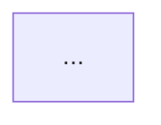

# Atividade da Aula 7 — Modelagem e diagramas

**Valor:** 0,25 (compõe o 1,0 de atividades de aula da Unidade 2)
**Formato:** produção em grupo (3 a 5 pessoas), **entrega individual** no Teams
**Prazo:** hoje, 24/09, até 23h59

---

## O que o grupo produz

Dois diagramas em **`docs/diagramas/`** e duas seções do arquivo **`docs/projeto.md`** do repositório do grupo. Os nomes das seções são exatamente estes — a correção procura por eles. **As duas seções já existem no template**; o que se cria hoje é a pasta `docs/diagramas/`.

Tudo entra por **PR revisado**, como qualquer mudança desde a Aula 6.

### 1. Os dois diagramas, um arquivo cada

- `docs/diagramas/contexto.md` — o sistema como **uma** caixa, os atores e sistemas externos em volta, o que atravessa a fronteira nas setas.
- `docs/diagramas/dados.md` — as entidades, os atributos que **decidem alguma regra**, a cardinalidade, e a transição de estado que faz a doação aceita sair da lista.

Formato: **texto diffável de preferência** — Mermaid, que o GitHub desenha dentro do próprio Markdown, resolve. Imagem é aceita **desde que o fonte vá junto** e o desenho seja regerável. UML não é exigida; **legenda** é.

Cada arquivo começa com três linhas **em texto comum**, acima do bloco do desenho e **fora** dele — dentro do bloco `mermaid` elas quebram o desenho. A forma é esta:

~~~markdown
- **Pergunta:** <a pergunta que este diagrama responde, em uma linha>
- **Decisão que sustenta:** <o número e o nome da decisão em ## Decisões de projeto>
- **Situação:** retrato da `main` no commit `<hash>` — ou — proposta, ainda não implementado


~~~

O *hash* do retrato é o do **último commit da `main` que o diagrama descreve** — não o do commit que traz o diagrama, que ainda não existe quando vocês escrevem.

Sem essas três linhas o diagrama não conta — é volume, não argumento (premissa 4).

Três regras sobre o desenho:

- **Toda seta tem rótulo.** "Usa" e "interage com" não são rótulo.
- **No máximo 9 elementos** por diagrama e **um nível de abstração** por desenho.
- **A vigilância sanitária aparece no de contexto**, mesmo sem usar a tela. Quem ficou de fora do mapa de stakeholders da Aula 2 tem o motivo escrito.

### 2. `## Diagramas`

Uma linha por diagrama: o link para o arquivo, a pergunta e a decisão que ele sustenta. Logo abaixo, **três linhas de divergência** entre o diagrama de dados e o `src/db.js` do repositório de vocês — para cada uma, se é **proposta** para a Unidade 3 ou **erro do desenho** que vocês corrigiram. Duas perguntas que a divergência precisa responder:

- **O instante do aceite existe no banco?** Se não, com o que vocês calculam o objetivo de impacto da Aula 2?
- **`ong` é coluna ou entidade?** Qualquer das duas vale — desde que seja escolha declarada, e que o diagrama e o banco digam a mesma coisa ou a diferença esteja marcada.

### 3. `## Uso de IA`

É o registro do trabalho 3 (gerar um dos diagramas com IA e apontar 2 erros). Para **cada um dos 2 erros**:

- **o tipo** — marketplace genérico, ator sumido, abstração nivelada, componente inventado, restrição evaporada, seta muda ou modelo de dados genérico (os sete cheiros da aula);
- **o que vocês mudaram no diagrama entregue — e por quê.**

"Ajustamos o layout" não é registro. E a correção tem de estar **no diagrama**, não só no texto.

---

## Além dos diagramas

- **Cada integrante faz ao menos um commit hoje** — ou aparece como `Co-authored-by:` no commit do par. O histórico do repositório é o que comprova participação.
- **CI verde** e a `main` **protegida**. Grupo que ainda não trancou a `main` na Aula 6 tranca hoje.

---

## Como entregar

Cole no campo de resposta, exatamente estas três linhas:

```
Repositório: <url do repositório do grupo>
Commit da entrega: <url do commit na main que contém docs/diagramas/ e as duas seções>
Meu commit de hoje: <url de um commit seu, feito hoje>
```

Cada integrante entrega. A produção é do grupo; a entrega é individual, porque a nota é individual.

---

## Como é corrigido

**Binário: entregou no prazo e no formato, pontuou.** Não há nota parcial e não há avaliação de mérito aqui.

Perde o ponto quem: entrega fora do prazo · entrega um diagrama só · entrega diagrama sem a **pergunta** acima · não marca **retrato** ou **proposta** · não escreve as três linhas de divergência com o `db.js` · deixa `## Uso de IA` em branco **ou nele não nomeia os 2 erros pelo tipo** · não tem commit próprio de hoje · manda o link do repositório sem o link do commit.

**A qualidade dos diagramas é avaliada depois**, e vale muito mais: "diagramas legíveis e suficientes" é critério de aceite do **Trabalho 2** (2,0 do artefato). Na **defesa individual** (1,0) em **22/10**, cada integrante responde por **qualquer** seta dos diagramas do grupo — inclusive as que não desenhou e as que a IA desenhou primeiro. A pergunta da defesa é quase sempre a mesma: **de onde veio essa seta?**

---

## Nível de IA nesta atividade: **IA como colaboradora**

**Pode:** gerar o rascunho de um diagrama, converter desenho em texto, revisar o que vocês desenharam, apontar o ator ou a seta que falta. E funciona melhor como **revisora** do que como autora — "que pergunta este diagrama não responde?" e "que ator do caso não aparece aqui?" rendem mais que "desenhe a arquitetura".

**Continua sendo de vocês:** a pergunta de cada diagrama, a decisão que ele sustenta, o que entra e o que fica de fora, e a leitura das divergências com o `db.js`.

**O protocolo de verificação, em três passos** — é o que a defesa vai cobrar:

1. **Confrontem com o caso.** Esse elemento existe no caso? Quem decidiu que ele existe?
2. **Confrontem com as decisões da Aula 6 e com o código.** O diagrama sustenta a decisão, ou contradiz o `db.js`?
3. **Confrontem com o teto de peças e o nível de abstração**, e registrem a correção em `## Uso de IA`.

Em qualquer nível, vocês continuam responsáveis por **verificar, testar, corrigir e defender** o resultado. Na defesa de 22/10 não há consulta e não há IA — e **"a IA desenhou assim" não é justificativa aceita**.
